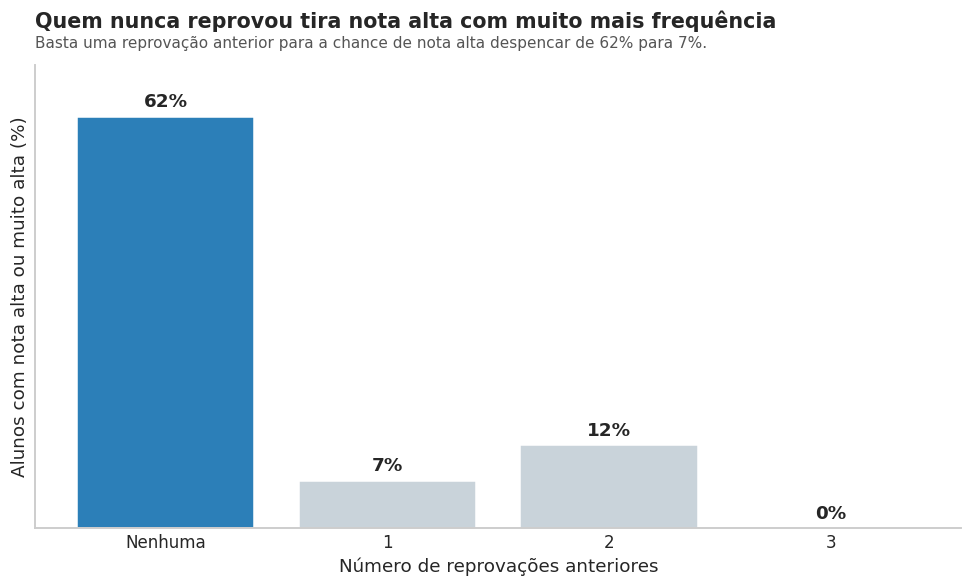
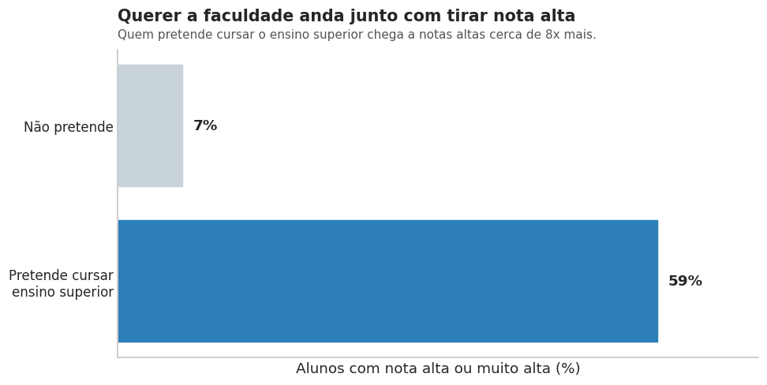
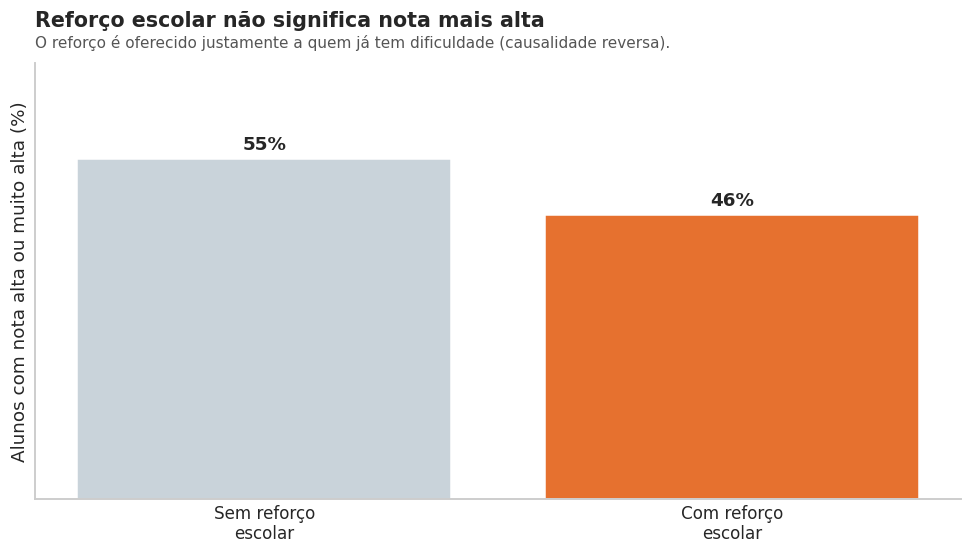

# Desempenho escolar: análise exploratória e pipeline de pré-processamento

Análise exploratória completa do dataset **UCI Student Performance** (649 alunos de duas escolas públicas de Portugal, disciplina de Língua Portuguesa), seguida da construção de um pipeline de pré-processamento com scikit-learn pronto para modelagem. Todas as análises seguem o formato **hipótese, análise e conclusão**.

Projeto da disciplina **Análise e Preparação de Dados** da Especialização em Inteligência Artificial e Ciência de Dados da PUCPR (Prof. Jean Paul Barddal).



## O que foi feito

1. **Carga, limpeza e validação**: checagem de ausentes, duplicatas, tipos e domínios de cada coluna contra o dicionário oficial.
2. **Engenharia da variável-alvo**: a nota final `G3` (0 a 20) foi discretizada em 5 classes (`very low`, `low`, `medium`, `high`, `very high`).
3. **Tratamento de vazamento**: as notas parciais `G1` e `G2` têm correlação acima de 0,9 com `G3`. Mantê-las faria qualquer modelo futuro "acertar" a nota final copiando as parciais, então foram removidas do conjunto preditivo.
4. **Descrição estatística**: 649 instâncias, 30 atributos preditivos, 5 classes e sua distribuição.
5. **Análise univariada de 20 variáveis**, agrupadas por tema (acadêmicas, capital familiar, estilo de vida, contexto sociodemográfico), com distribuição, assimetria, curtose, média, desvio padrão e gráfico adequado ao tipo de cada variável.
6. **Análise multivariada com 10 hipóteses**, incluindo PCA com biplot.
7. **5 gráficos finais redesenhados para público leigo**, com título que já entrega a conclusão, cor de destaque e rótulos diretos.
8. **Pipeline de pré-processamento** com `ColumnTransformer` e `Pipeline`.

## Principais achados

* **Reprovações anteriores são o sinal mais forte**: 62% dos alunos sem reprovação tiram nota alta ou muito alta; com uma reprovação, apenas 7%.
* **Aspiração ao ensino superior pesa muito**: 59% dos que pretendem cursar faculdade estão nas faixas altas, contra 7% dos que não pretendem.
* **Escolaridade dos pais** e **tempo de estudo** crescem junto com a nota, como esperado.
* **Achado não óbvio 1, reforço escolar**: alunos que recebem apoio escolar (`schoolsup`) têm notas *mais baixas*. O apoio não piora o aluno; ele é oferecido justamente a quem já está com dificuldade, um caso clássico de causalidade reversa.
* **Achado não óbvio 2, faltas**: o efeito das faltas sobre a nota é surpreendentemente fraco (a faixa média cai pouco de zero faltas para mais de dez).
* **Tempo de deslocamento não explica faltas**: as médias de faltas são praticamente iguais em todos os níveis de `traveltime`.

<p>


</p>

## Pipeline

As colunas são tratadas conforme o tipo:

| Tipo | Colunas | Transformação |
|---|---|---|
| Binárias | `school`, `sex`, `address`, `higher`, `internet` e outras 8 | `OrdinalEncoder` (0/1) |
| Nominais | `Mjob`, `Fjob`, `reason`, `guardian` | `OneHotEncoder(drop="first")` |
| Numéricas e ordinais | `age`, `Medu`, `Fedu`, `studytime`, `failures`, `absences` e outras 7 | padronização, re-escala ou normalização |

São montadas três variantes do pipeline para comparar as técnicas: **padronização** (`StandardScaler`), **re-escala** (`MinMaxScaler`) e **normalização** (`Normalizer` L2). A divisão treino/teste (80/20, estratificada) é feita antes do `fit`, de modo que as estatísticas de escala vêm só do treino. O resultado são 39 features prontas para um classificador.

## Estrutura

```
.
├── analise_student_performance.ipynb   # notebook completo, executado
├── dados/
│   ├── student-por.csv                 # base usada (Português, 649 alunos, separador ;)
│   ├── student-mat.csv                 # base de Matemática (não usada, mantida por completude)
│   └── student.txt                     # dicionário oficial dos atributos
└── figuras/                            # os 5 gráficos finais
```

## Como executar

```bash
pip install -r requirements.txt
jupyter notebook analise_student_performance.ipynb
```

O notebook carrega a base direto do UCI com o pacote `ucimlrepo`. Para rodar sem internet, use a cópia local:

```python
df = pd.read_csv("dados/student-por.csv", sep=";")
```

## Dados

P. Cortez e A. Silva (2008), *Using Data Mining to Predict Secondary School Student Performance*. Disponível no [UCI Machine Learning Repository](https://archive.ics.uci.edu/dataset/320/student+performance) sob licença CC BY 4.0.

## Tecnologias

Python, pandas, NumPy, SciPy, Matplotlib, seaborn, scikit-learn.

## Autores

Projeto em grupo (Grupo 4):

* **César Willian Pacheco**
* Félix Augustus Motelevicz
* Gabriel Molec
